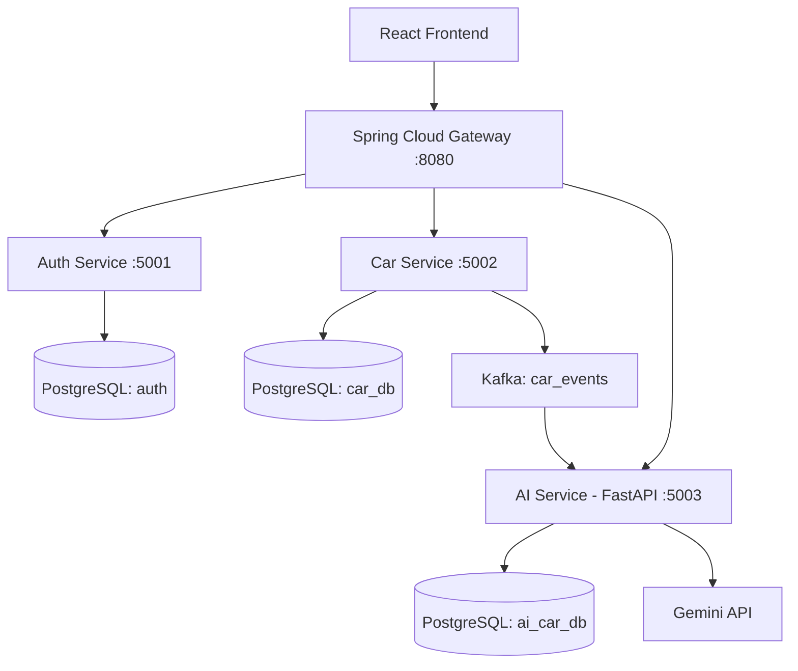

# CarPulse — Phân tích thị trường ô tô cũ Việt Nam

> Dự án môn **Service-Oriented Architecture (SOA)** — Nhóm 11, lớp SOA1.

CarPulse là nền tảng quản lý và phân tích dữ liệu ô tô cũ, kết hợp kiến trúc microservices với các thuật toán AI/ML để hỗ trợ phân khúc thị trường, gợi ý xe tương tự và phân tích thông tin thị trường.

## Tính năng chính

- Quản lý dữ liệu xe thông qua REST API.
- Đăng ký, đăng nhập và phân quyền người dùng bằng Spring Security và JWT.
- Đồng bộ sự kiện CREATE/UPDATE/DELETE từ Car Service đến AI Service thông qua Apache Kafka.
- Phân khúc xe theo giá bằng K-Means.
- Gợi ý xe tương tự dựa trên giá, năm sản xuất và số km đã đi.
- Khai phá luật kết hợp bằng Apriori.
- Chat tư vấn và Market Debate sử dụng Gemini API, kết hợp truy xuất ngữ cảnh từ dữ liệu thị trường.
- Áp dụng Rate Limiting và Circuit Breaker tại API Gateway.

## Công nghệ sử dụng

| Thành phần     | Công nghệ                                    | Vai trò                                               |
| -------------- | -------------------------------------------- | ----------------------------------------------------- |
| Frontend       | React, Axios                                 | Giao diện người dùng, gọi API qua Gateway             |
| API Gateway    | Spring Cloud Gateway                         | Định tuyến request, CORS và các cơ chế bảo vệ dịch vụ |
| Auth Service   | Java, Spring Boot, Spring Security           | Xác thực, phân quyền và quản lý token                 |
| Car Service    | Java, Spring Boot, Spring Kafka              | CRUD dữ liệu xe và phát sự kiện Kafka                 |
| AI Service     | Python, FastAPI, scikit-learn, Pandas, NumPy | Phân tích dữ liệu và cung cấp tính năng AI/ML         |
| Database       | PostgreSQL, Flyway                           | Lưu trữ dữ liệu và quản lý migration                  |
| Message Broker | Apache Kafka, Zookeeper                      | Truyền sự kiện giữa các service                       |
| AI/LLM         | Gemini API                                   | Hỗ trợ chat và phân tích lập luận thị trường          |
| Resilience     | Resilience4j                                 | Rate Limiting và Circuit Breaker tại Gateway          |

## Kiến trúc tổng quan



Car Service phát sự kiện khi dữ liệu xe được tạo, cập nhật hoặc xóa. AI Service nhận sự kiện để đồng bộ dữ liệu phục vụ phân tích. Các service sử dụng database riêng để tách biệt dữ liệu theo trách nhiệm.

## Cấu trúc repository

```text
SOA_new_24_6-main/
├── gateway-api/       # API Gateway
├── authservice/       # Xác thực và quản lý người dùng
├── carservice/        # API quản lý xe và Kafka Producer
├── aiservice/         # FastAPI, AI/ML và Kafka Consumer
├── frontend/          # React application
├── docker-compose.yml # Kafka và Zookeeper
├── setup-databases.sql
└── README.md
```

## Yêu cầu môi trường

- JDK 17 trở lên
- Maven 3.8 trở lên
- Python 3.10 trở lên
- Node.js và npm
- PostgreSQL 14 trở lên
- Docker Desktop
- Gemini API key để sử dụng các tính năng AI cần LLM

## Cài đặt và chạy local

> Các service nên được chạy trong những terminal riêng. Hãy kiểm tra port và cấu hình thực tế trong repository trước khi khởi động.

### 1. Khởi động Kafka và Zookeeper

Tại thư mục gốc dự án:

```powershell
docker-compose up -d
docker-compose ps
```

### 2. Tạo database

Chạy `setup-databases.sql` bằng `psql` hoặc công cụ quản trị PostgreSQL. Dự án sử dụng ba database: `auth`, `car_db` và `ai_car_db`.

Cấu hình thông tin kết nối database cho từng service bằng biến môi trường hoặc cấu hình local. Auth Service và Car Service sử dụng Flyway để quản lý migration. AI Service cần có dữ liệu/bảng đầu vào phù hợp để chạy các tính năng phân tích.

### 3. Chạy Auth Service

```powershell
cd authservice
mvn spring-boot:run
```

Mặc định: `http://localhost:5001`

### 4. Chạy Car Service

Mở terminal mới:

```powershell
cd carservice
mvn spring-boot:run
```

Mặc định: `http://localhost:5002`

Đảm bảo Kafka và cấu hình kết nối tới PostgreSQL đã sẵn sàng.

### 5. Chạy API Gateway

Mở terminal mới:

```powershell
cd gateway-api
mvn spring-boot:run
```

Mặc định: `http://localhost:8080`

### 6. Chạy AI Service

Mở terminal mới:

```powershell
cd aiservice
python -m venv venv
.\venv\Scripts\Activate.ps1
pip install -r requirements.txt
uvicorn main:app --reload --host 0.0.0.0 --port 5003
```

Tạo/cấu hình file `.env` theo các biến mà ứng dụng sử dụng, bao gồm `DATABASE_URL`, `OPENAI_API_KEY`, `OPENAI_BASE_URL` và `KAFKA_BOOTSTRAP_SERVERS`. `OPENAI_API_KEY` trong cấu hình tương thích OpenAI được dùng để cung cấp Gemini API key theo thiết lập hiện tại của dự án. Không đưa API key hoặc mật khẩu thật lên Git.

Mặc định: `http://localhost:5003`; tài liệu FastAPI thường có tại `http://localhost:5003/docs`.

### 7. Chạy Frontend

Mở terminal mới:

```powershell
cd frontend
npm install
npm start
```

Frontend mặc định chạy tại `http://localhost:3000`. Kiểm tra biến `REACT_APP_API_BASE_URL` để đảm bảo ứng dụng gọi đúng API Gateway, ví dụ `http://localhost:8080/api` khi phù hợp với cấu hình hiện tại.

## API tiêu biểu

Các endpoint dưới đây được gọi thông qua API Gateway tại `http://localhost:8080`. Endpoint và quyền truy cập chính xác phụ thuộc cấu hình route/security của từng service.

| Nhóm  | Method   | Endpoint                                   | Mô tả                             |
| ----- | -------- | ------------------------------------------ | --------------------------------- |
| Auth  | `POST`   | `/api/auth/register`                       | Đăng ký tài khoản                 |
| Auth  | `POST`   | `/api/auth/login`                          | Đăng nhập                         |
| Auth  | `POST`   | `/api/auth/refresh`                        | Làm mới access token              |
| Auth  | `GET`    | `/api/auth/me`                             | Lấy thông tin người dùng hiện tại |
| Auth  | `PUT`    | `/api/auth/profile`                        | Cập nhật hồ sơ                    |
| Cars  | `GET`    | `/api/cars`                                | Danh sách xe                      |
| Cars  | `GET`    | `/api/cars/{id}`                           | Chi tiết xe                       |
| Cars  | `POST`   | `/api/cars`                                | Thêm xe và phát sự kiện Kafka     |
| Cars  | `PUT`    | `/api/cars/{id}`                           | Cập nhật xe và phát sự kiện Kafka |
| Cars  | `DELETE` | `/api/cars/{id}`                           | Xóa xe và phát sự kiện Kafka      |
| AI/ML | `GET`    | `/api/ai/segments`                         | Phân khúc thị trường              |
| AI/ML | `GET`    | `/api/ai/segments/{id}/cars`               | Danh sách xe theo phân khúc       |
| AI/ML | `GET`    | `/api/ai/recommendations/similar/{car_id}` | Gợi ý xe tương tự                 |
| AI/ML | `GET`    | `/api/ai/association-rules`                | Luật kết hợp Apriori              |
| AI    | `POST`   | `/api/ai/chat`                             | Chat tư vấn ô tô                  |
| AI    | `POST`   | `/api/ai/debate`                           | Phân tích lập luận thị trường     |

Swagger UI của Auth Service và Car Service thường có tại:

- `http://localhost:5001/swagger-ui.html`
- `http://localhost:5002/swagger-ui.html`

## Bảo mật và kiểm thử

- Mật khẩu được băm bằng BCrypt.
- JWT được dùng để xác thực request; refresh token được trả qua HTTP-only cookie theo flow hiện tại.
- Rate Limiting và Circuit Breaker được cấu hình tại API Gateway.
- Các bài test Spring Boot hiện có chủ yếu là kiểm tra application context; cần bổ sung unit test và integration test để kiểm tra nghiệp vụ, bảo mật và luồng Kafka.

**Lưu ý bảo mật:** Không commit `.env`, API key, mật khẩu database hoặc JWT secret. Trước khi triển khai công khai, cần rà soát cấu hình secret, cookie `Secure` khi dùng HTTPS, luồng logout/revoke refresh token và việc bảo vệ trực tiếp AI Service.

## Giới hạn hiện tại và hướng phát triển

- Cần bổ sung unit test và integration test cho các service.
- Hoàn thiện luồng logout và thu hồi refresh token.
- Củng cố cơ chế xác thực khi truy cập trực tiếp AI Service.
- Thay các cấu hình nhạy cảm hoặc địa chỉ service cố định bằng biến môi trường phù hợp từng môi trường.
- Có thể bổ sung service discovery và CI/CD trong các phiên bản tiếp theo.

## Đóng góp và thông tin dự án

- **Môn học:** Service-Oriented Architecture (SOA)
- **Nhóm:** Nhóm 11 — Lớp SOA1
- **Repository:** (https://github.com/ManhDung2k4/SOA_new_24_6)
